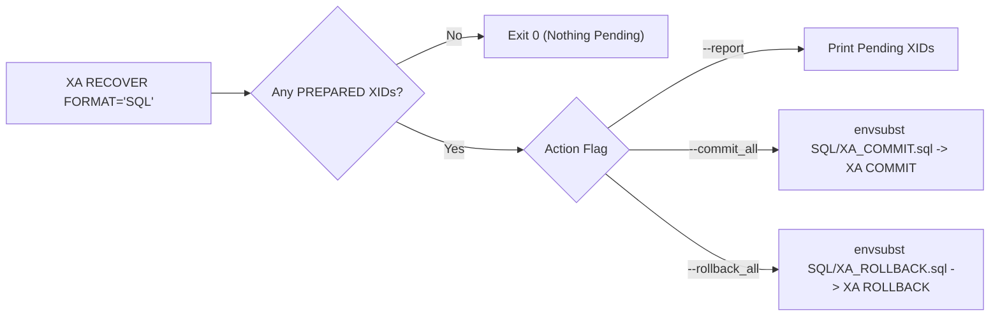

# MariaDB XA Settle

Commit or rollback all unsettled XA transactions in `PREPARED` state on MariaDB.

> [!CAUTION]
> **Use At Your Own Risk:** Prepared XA transactions hold row locks until resolved. Always inspect `mariadb_xa_settle.sh --report` and confirm distributed coordinator state before committing or rolling back transactions in production.

## Recovery Workflow



## Documentation Portal (Diátaxis)

- **Tutorials:** [Isolated Docker MariaDB XA Transaction Lab](docs/01-tutorials/index.md)
- **How-To Guides:** [Operational Runbooks in ASD-STE100 Issue 9](docs/02-how-to-guides/index.md)
- **Reference:** [CLI Options, Client Config, SQL Templates & Dependencies](docs/03-reference/index.md)
- **Explanation:** [XA Transaction States & Two-Phase Commit Recovery](docs/04-explanation/index.md)

## Download & Prerequisites

Clone this repository or download the archive (`fork` of [`mariadb-edwardstoever/mariadb_xa_settle`](https://github.com/mariadb-edwardstoever/mariadb_xa_settle)):

```bash
git clone https://github.com/jmrenouard/mariadb_xa_settle.git
```

Prerequisites on the Linux database host or jump host:

- `bash` (`>= 4`), `mariadb` (or `mysql`) client, and `my_print_defaults`
- `envsubst` (`gettext` package), `awk`, and GNU `sed` (`-z`)

## Connecting from the Database Host

By default, `mariadb_xa_settle.sh` connects via `unix_socket` (typically `root@localhost`). To authenticate with another user or remote socket/TLS endpoint, configure `[mariadb_xa_settle]` inside [`xa_settle.cnf`](xa_settle.cnf) and restrict permissions with `chmod 600 xa_settle.cnf`.

## Running a Testing Scenario

Create the `test_xa.xa_table` test schema with five prepared, unsettled XA transactions:

```bash
./setup_test_xa_schema.sh
```

Run `./setup_test_xa_schema.sh` multiple times to create additional prepared transactions. Remove the test schema afterward with:

```bash
./cleanup_test_xa_schema.sh
```

## CLI Usage & Options

```bash
./mariadb_xa_settle.sh --report
./mariadb_xa_settle.sh --rollback_all
./mariadb_xa_settle.sh --rollback_all --pause 5
./mariadb_xa_settle.sh --interactive --commit_all
./mariadb_xa_settle.sh --interactive --rollback_all
./mariadb_xa_settle.sh --commit_all --pause 5
```

| Flag | Purpose |
| :--- | :--- |
| `--report` | Display prepared XA transactions without committing or rolling back |
| `--commit_all` | Commit all prepared XA transactions |
| `--rollback_all` | Roll back all prepared XA transactions |
| `--interactive` | Require confirmation (`C` or `c`) before executing commit/rollback |
| `--pause [seconds]` | Pause between transactions in non-interactive mode (default `2` seconds) |
| `--help` | Display help message and version (`vsn.sh`) |
