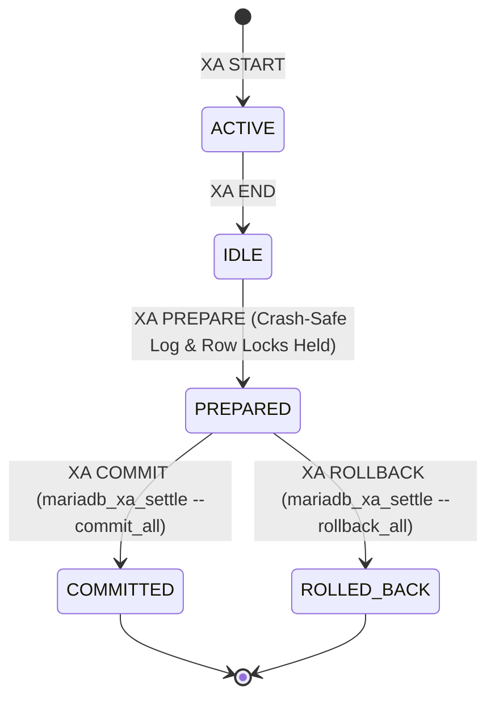
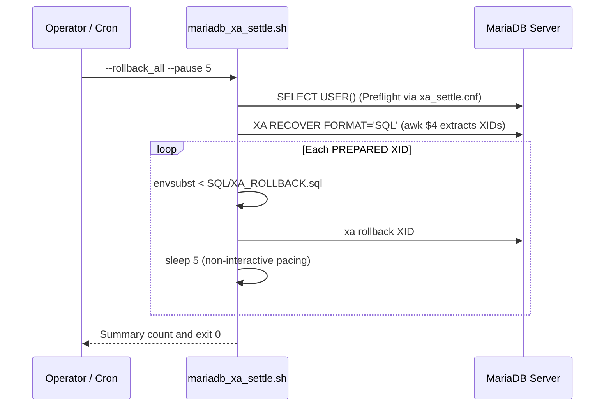

# XA Two-Phase Recovery Architecture

MariaDB XA transactions follow the X/Open XA Two-Phase Commit (`2PC`) protocol so multiple resource managers agree before durable commit or rollback.

## XA Transaction State Lifecycle

## Settlement Pipeline (`mariadb_xa_settle.sh`)

## Operational Design Trade-Offs

### 1. Why `PREPARED` Transactions Survive Server Restarts

- When a coordinator crashes after `XA PREPARE`, MariaDB persists the prepared XID in its redo log and holds InnoDB row locks across server restarts.
- Other normal sessions encounter `Lock wait timeout exceeded` (`cleanup_test_xa_schema.sh` explicitly demonstrates this lock contention with `max_statement_time=3`) until every orphan XID receives `XA COMMIT` or `XA ROLLBACK`.

### 2. Why `--commit_all` vs `--rollback_all` Requires Human Judgment

- An automated script cannot inspect the external transaction manager log to determine whether sibling resource managers committed or aborted phase 2.
- Committing locally when peer databases rolled back creates split-brain data, whereas rolling back drops orphan writes so coordinators can safely retry idempotent workloads.

### 3. Why `XA RECOVER FORMAT='SQL'` Simplifies Recovery Parsing

- Classic `XA RECOVER` emits raw hex/text fields that require custom escaping whenever `gtrid` or `bqual` contain binary bytes.
- MariaDB's `FORMAT='SQL'` outputs an already-quoted `'gtrid','bqual',formatID` tuple directly in column `4`, letting `awk '{print $4}'` feed `envsubst` safely.
