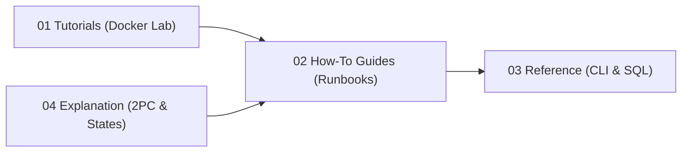

# MariaDB XA Settle Documentation

Structured Diátaxis documentation for inspecting and resolving `PREPARED` XA transactions with `mariadb_xa_settle`.

## Quadrants

| Quadrant | Focus | Entry Point |
| :--- | :--- | :--- |
| **Tutorials** | Hands-on ephemeral MariaDB XA lab | [Tutorials Index](01-tutorials/index.md) |
| **How-To Guides** | ASD-STE100 operational XA recovery procedures | [How-To Guides Index](02-how-to-guides/index.md) |
| **Reference** | CLI flags, `[mariadb_xa_settle]` options & SQL templates | [Reference Index](03-reference/index.md) |
| **Explanation** | Two-phase commit (`2PC`) & orphan `PREPARED` XIDs | [Explanation Index](04-explanation/index.md) |

[Back to Repository Overview](../README.md)
